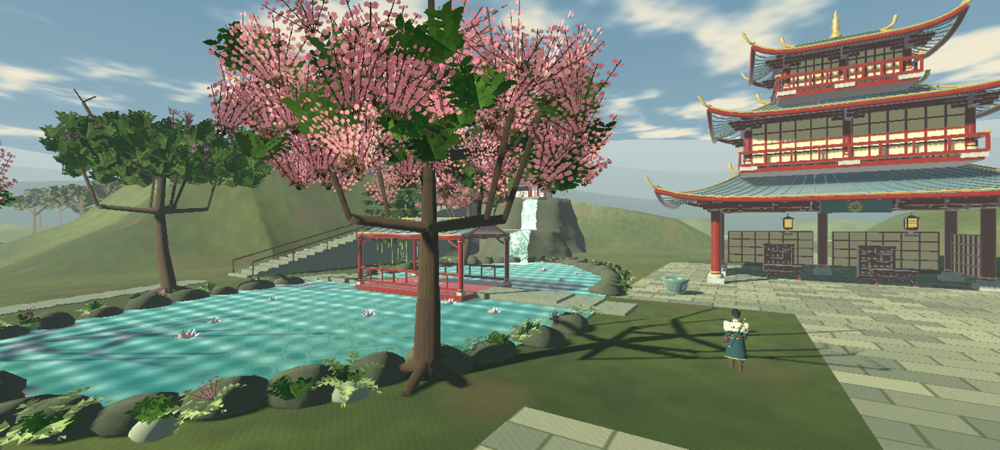
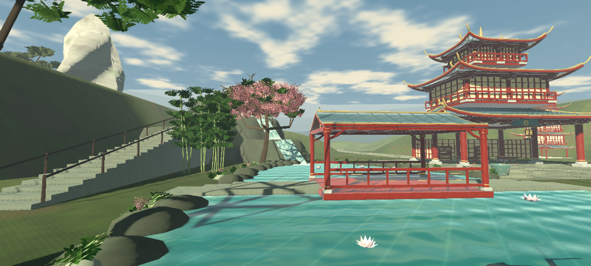
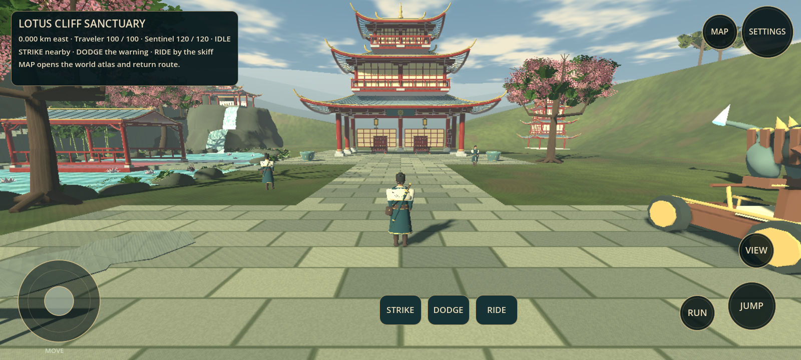
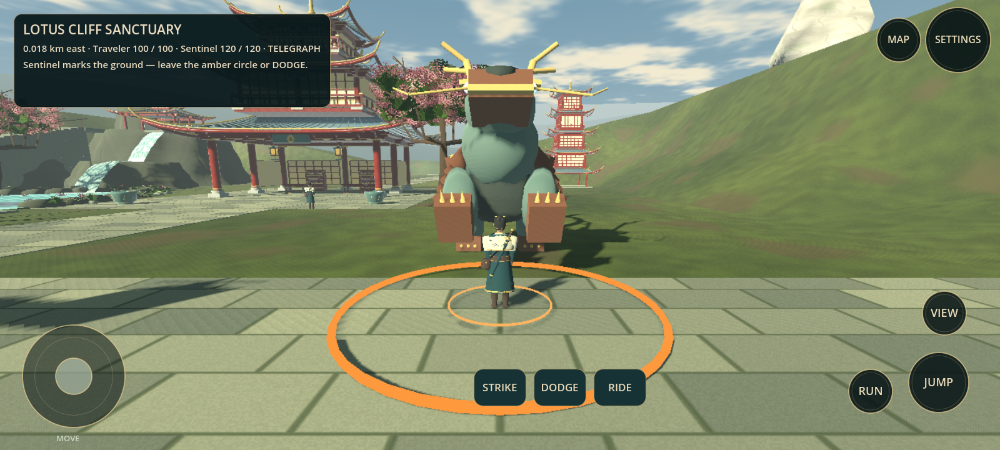
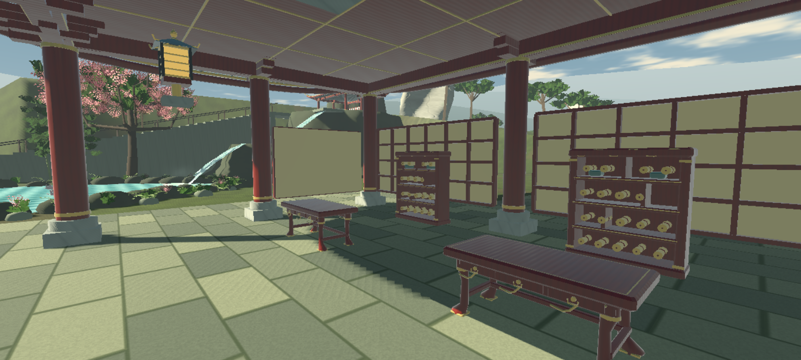
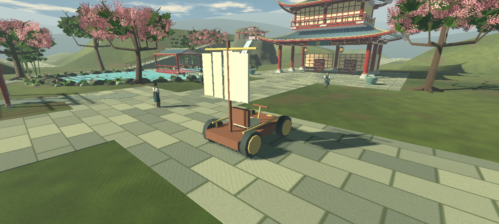

# Temple Realm v0.6.1 — actual game screenshots

These are unmodified screenshots rendered from the playable Godot source, not concept images. Desktop Compatibility renderer / Mesa llvmpipe, 1600×720, Balanced. Realme FPS and thermal behavior are not measured. This remains stylized prototype artwork, below the reference pack's fidelity.

Enter from **MAP → EXPLORE THE JADE EXPANSE**. The origin Lotus Cliff Sanctuary is deliberately composed; farther regions are generated from repeated modules across a 200,000 km span.

[Download all thirteen screenshots and verification data](TempleRealm_v0.6.1_Screenshots.zip)

## Lotus Cliff Sanctuary

This stability update adds articulated guardian warnings/impact, a saved region journal and collision-resource caching. The scenery composition is unchanged; this is not a claim of GTA/Genshin-level fidelity.

## Playable arrival and guardian encounter

## Furnished hall and travel

[World atlas](screenshots/v0.6/09-world-atlas.png) · [Pavilion view](screenshots/v0.6/12-pavilion-view.png) · [Resident](screenshots/v0.6/13-keeper.png)

Camera views without the HUD are staged cinematic views inside the same real scene. Gameplay and atlas views retain the actual interface. Exact app input hashes and render counters are included in [render evidence](screenshots/v0.6/render-evidence.json).
